# zmk-config-roBa

## キーマップ同期

`config/roBa.keymap` は自動生成ファイル。マスターは
[dgarai/zmk-config-moNa2-v2](https://github.com/dgarai/zmk-config-moNa2-v2) の
`config/mona2.keymap`。**キーマップを変えたいときはマスターを編集する。**
このリポジトリを編集しても次の同期で上書きされる。

詳細と元に戻す手順は [KEYMAP-SYNC.md](KEYMAP-SYNC.md) を参照。
